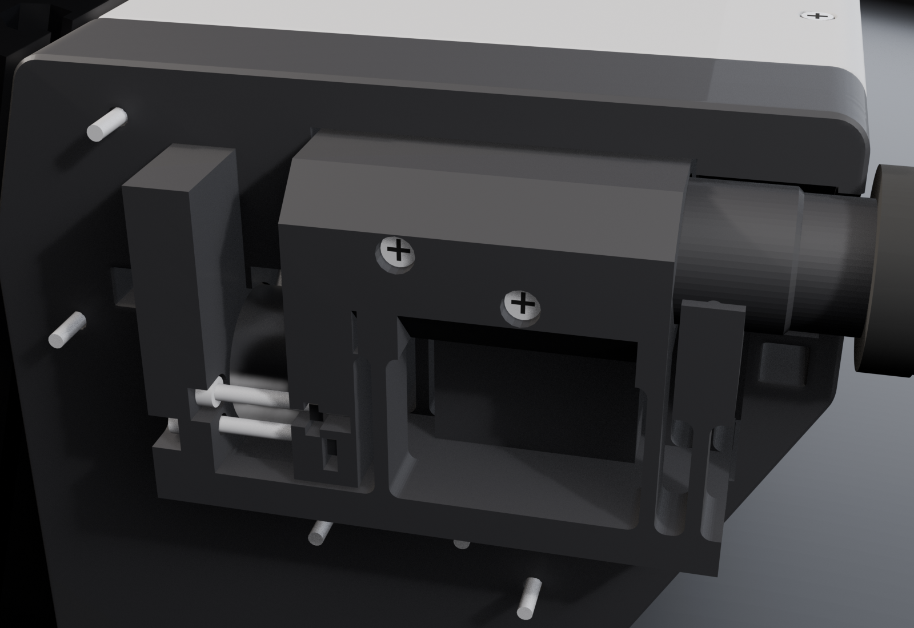
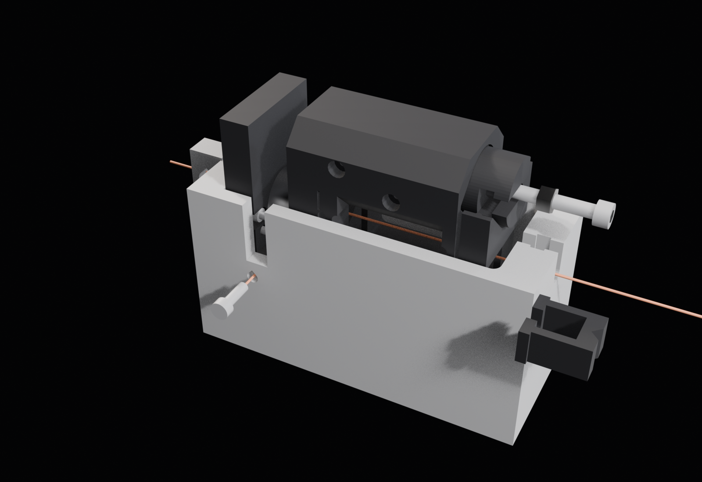
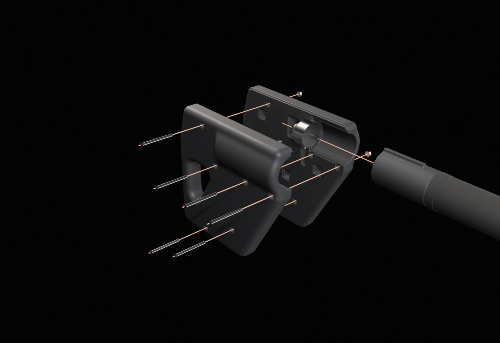
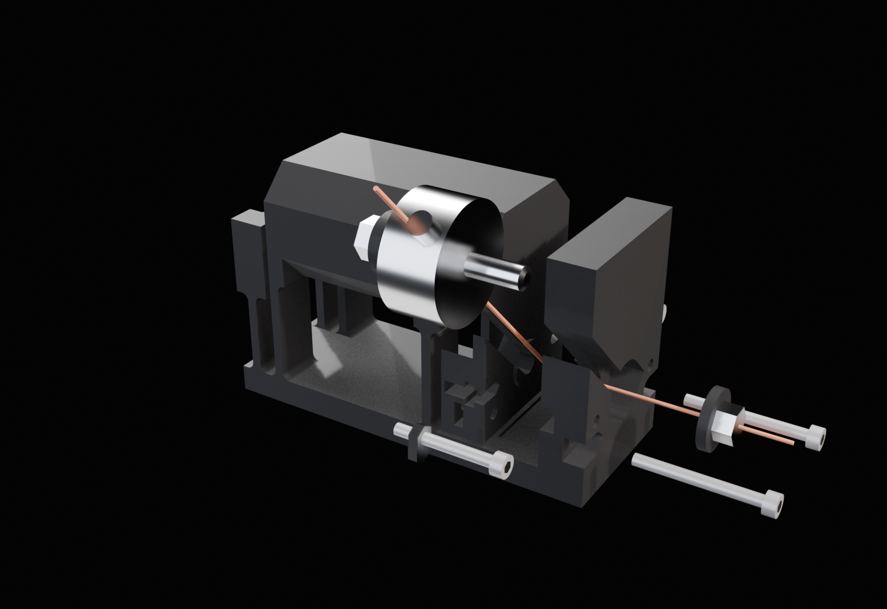
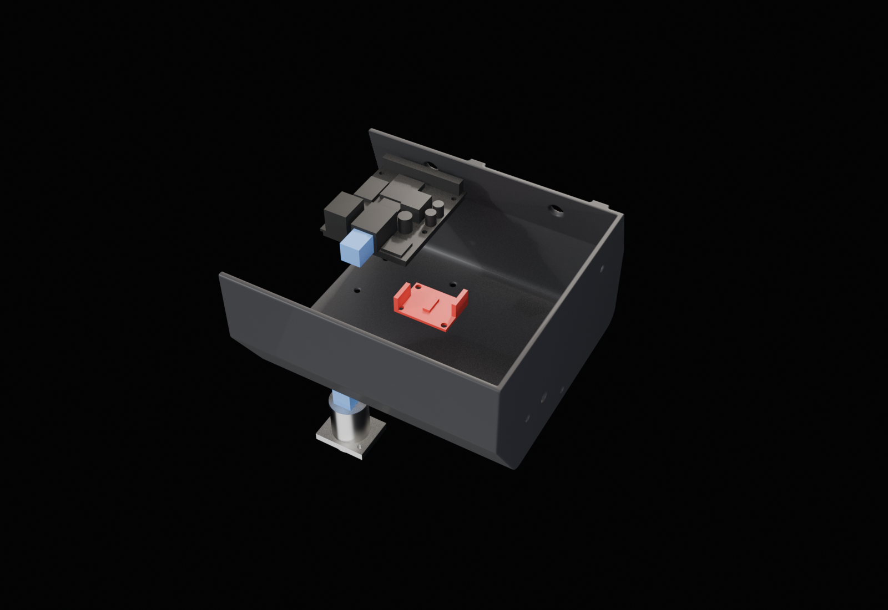
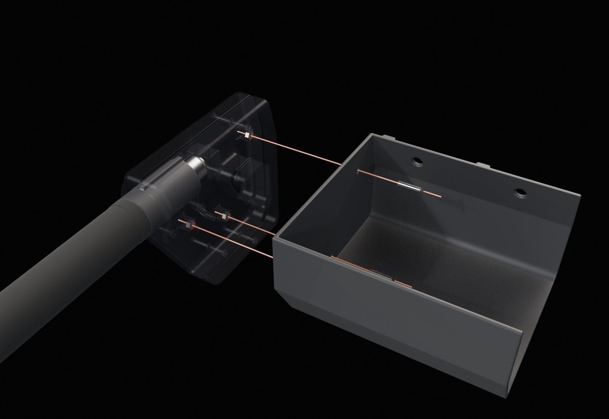
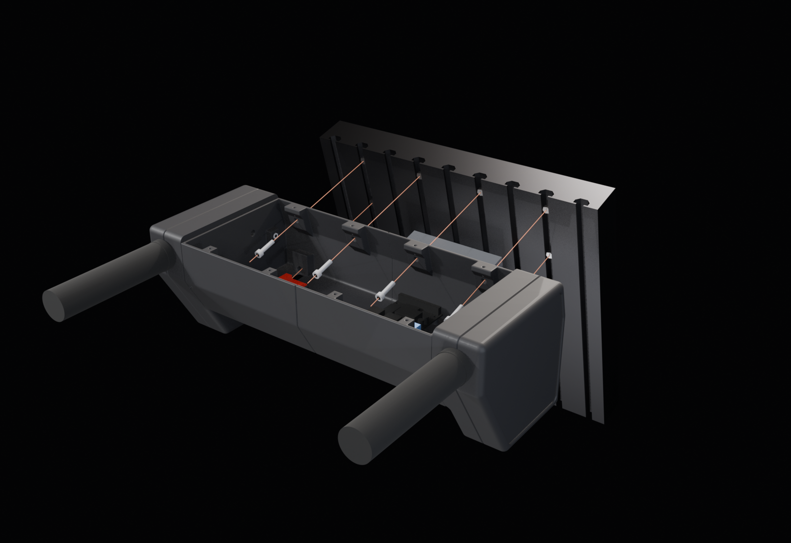

# Space bar push assist

Push-assist handles for a powered wheelchair. A load cell in each handle measures how hard the
attendant pushes. The sum of the two forces is the forward command, and the difference is the
turn. An ESP32-P4 reads both cells and publishes the two handle forces; the MIB turns them into
forward and turn commands for its trajectory planner, the same way it drives from the joystick.

This repo holds the mechanical concept (a parametric Blender build of the printed parts, and a 2D
profile script used to agree the shape before building it in 3D) and the handle firmware:

- [`firmware/`](firmware/README.md): ESP-IDF + espp app that reads both load cells, tracks their
  zero and serves the forces over ethernet to a live HTML dashboard.
- [`docs/MIB-INPUT-DEVICES.md`](docs/MIB-INPUT-DEVICES.md): how the MIB should take this (or any)
  input device: devices measure, the MIB decides. Includes the reference push-to-drive
  conversion and what is left to build in rammp-rtps, this firmware and the MIB.


## Hardware

| Part | Notes |
|---|---|
| 2x tension/compression load cell, **20 kg** | JHD puck, Ø25.4 × 12.7 mm, M5 studs 12.15 mm long, one per handle. Note its rated output (mV/V) from the label or calibration sheet. See "Which cell" below |
| 2x SparkFun Load Cell Amp HX711 (SEN-13879) | One 24-bit amp per load cell, read by [`firmware/`](firmware/README.md). Header pins soldered once (or bought fitted). Holes Ø3.3 on a 17.8 × 25.4 mm pattern (measured). |
| 8x female jumper wires | Amps to the ESP32's 40-pin header: CLK, DAT, 3V3, GND each (pins in `firmware/README.md`) |
| Waveshare ESP32-P4 WiFi6 PoE devkit | Reads the amps, serves the forces over Ethernet |
| Panel-mount RJ45 coupler | On a 5 mm pad in tray L, flange on top (two M3 × 12 self-tappers); nothing hangs below the floor. The PoE cable plugs in from below |
| 200 mm Cat6 patch cable | ESP32 jack to the coupler. The route is 150 mm; the other 50 mm lies loose in tray L |
| MTB lock-on grips | Over the printed Ø22.2 grip spigots (Ø33 flange) |
| M5 socket head caps + 40-series drop-in T-nuts | Six of them hold the unit to the chair's back plate |

Every screw is from the lab kit: ISO 4762 socket head caps (M3, M4, M5) into nuts or T-nuts, and M3
pan self-tappers into printed pilots. There are no countersunk screws; every head sits in a
flat-bottomed counterbore (M3 Ø6.5, M4 Ø8.0, M5 Ø9.5). There are no bought washers: the two
washers under each load cell's nuts are printed. The full list, generated from the model, is in
[`cad/BOM.md`](cad/BOM.md) (`cad bom` checks it against the model).

Printed in PLA. This is an R&D test unit. The two flexure cartridges and the four printed washers
carry the load cell's clamp: if the chair will be parked in a hot car or in sun, print those six
parts in PETG (same files, same orientation).

Bench tools (one set, used to set the overload stops): a printed cradle, setting plug and mass
hanger, an M5 × 35 jack screw with two M5 nuts, two M4 × 12 lip screws with nuts, the unit's
ESP32-P4 and one of its amps running [`firmware/`](firmware/README.md) as the force readout, a known mass (5 or 10 kg, for example a bag or a water
can, weighed on a kitchen scale) on a cord, and a hook or a door handle to hang the cradle from.

## Current design

The unit mounts on the back plate of a Permobil Corpus seat. That plate is a row of vertical 4040
extrusions leaning 15° past vertical.

- One unit, not two pods. The bridge between the handles holds the electronics, and each end
  carries a fin with a handle. Handles are 14 in apart. One cover spans both tray halves and
  screws to both, so it also joins them at the centre.
- The side section is a wedge. The top is level with the grip axis, the rear face slopes at
  60°, and the front face sits flat on the plate for 40 mm before turning vertical.
- The bridge is 92 mm tall so it clears the seat's central block (the one that holds the
  armrests). The fins run down to 140 mm.
- The unit hangs on six M5 bolts into T-nuts: four through the flat land at the top of the front
  face, two through feet down by the floor.
- Fin, tray and cover read as one body: where the tray and cover continue the fin, the fin's
  inboard edges are sharp and meet them on one hairline. The fin's own split is one deliberate
  1 mm V reveal round its outline (the two tray halves meet on the same reveal at the centre), and its outboard face carries a 2 mm recessed panel that
  follows the outline (attempt 3's clipped lightening window is gone).

### Load-cell head (attempts 5-8)

Each handle's load cell sits in a printed **flexure cartridge** inside the fin. The cartridge is a
self-contained module: the cell is clamped, settled and its overload stops set on the bench, and
nothing in it is touched again when it goes into the fin.



- The cartridge is one printed part. The fixed body is an 11.5 mm block and a ground bar. The
  moving body is the top link, which holds the piston socket on the grip axis, and a "drop" that
  reaches down from the link's front to the cell. Two parallel leaves join the bodies; each leaf
  is two 12.5 × 2.5 mm strips with r 2 fillets at all their roots. The cell's front stud clamps
  the cell to the block (washer and nut sit in a Ø16 counterbore in the block's front face); its
  rear stud clamps the drop.
- **No lean crosstalk (attempt 7).** The cell does not sit on the grip axis. It sits 28.5 mm
  below it, at the leaves' mid-height. A downward lean turns the link about the cell, which is
  the only stiff thing along the axis. With the cell on the leaves' mid-height, that turn bends no
  leaf, so it puts no axial force on the cell: 0 N at any lean (`head_calc.txt` 8; a 0.5 mm print
  error in that height gives 0.1 %). In attempt 6 the leaf tops were 15 mm below the cell axis,
  and 3.8 % of a lean showed up as push.
  - The push still acts on the grip axis. The leaves carry the 28.5 mm offset as a couple
    (about ±360 N in the strips at 600 N), and the turn it causes bends no leaf either.
  - The cradle's jack is on the grip axis too, so the stops are set under exactly the grip's
    loading.
- **The cell takes axial load only.** Each cell face bears on a Ø12 × 1.0 seat boss on the stud
  axis, and is 1.0 mm clear of the block and the drop everywhere else. So the leaves carry the
  grip's bending and side load around the cell. They add about 150 N/mm in parallel with the
  cell, a fixed shunt that calibrates out.
- **The cell goes in from the side.** Both stud holes continue as a 5.5 mm slot running
  up-inboard at 45° out through the inboard face, and behind the drop's wall a Ø14.4 channel runs
  the same way. The cell slides in along them, with its rear washer and nut already on the rear
  stud, and its wire boss points the same way. The 2.4 mm printed washers bridge the slot (11 MPa
  at 1.2 × FS pull). In attempt 7 the slots stopped 0.2 mm short of the inboard face, under a
  wedge of material, so the cell still could not be fitted. Now each slot's far end runs its own
  half width plus 1 mm past the face. This is proven by rows nothing blinds: the cell, its rear
  washer and its nut slide 90 mm out along the slot with the cartridge in the row (the cartridge
  × cell `allow` is gone), the insertion check finds that 45° line as the cell's only way in, and
  the exported STL is open across the whole path (`cad/review/attempts.md`, attempt 8).
- **Overload stops on the cell axis.** Four M3 socket caps run along the axis beside the cell.
  They thread into M3 nuts held in slots in the drop, so they move with it, and their heads act on
  the block.
  - The push pair is at the height of the cell axis. Its heads sit in counterbores in the block's
    rear face, and their top faces meet the counterbore floors when the grip is pushed.
  - The pull pair sits 6.5 mm below the axis and passes through the block. Its heads meet
    counterbore floors in the block's front face when the grip is pulled.
  - A downward lean turns the link about the cell. It does not move the push stops at all, and it
    opens the pull stops.
  - Each pair is set on the bench to the cell's own deflection at 1.2 × FS, so one print fits
    any cell.
- **Leans: a catch with no friction path (attempts 7-8).** Behind the rear leaf the fixed body
  carries a saddle under the piston, 0.15 mm clear. It stands on two thin legs that are stiff
  vertically but bend along the grip axis. The numbers below are in `head_calc.txt` 4, and each
  one is a `checks.json` row.
  - A lean of 200-280 N on one grip puts the piston on the saddle. A full 1.2 × FS pull lowers
    the piston 0.07 mm toward it, so a full pull plus a 100 N lean still clears it.
  - The saddle touches the piston only on an R1.2 crown across the grip axis. A line contact
    cannot hold the saddle square, so its legs bend as free cantilevers, at 11 N/mm. Attempt 7's
    flat face could be held square, which made them about 10 times stiffer.
  - Friction at the saddle drags the legs along with the piston, so it takes little push force
    from the cell: 1.3 N for a typical cell, and 3.4 N at the largest stop setting. A heavy lean
    may flatten the crown a little. After a 600 N lean, a later 300 N lean gives at most 7.4 N.
    **Open:** while 600 N rests on one grip, the shunt can reach about 20 N, over the 10 N dead
    band.
  - Past contact the rear strips keep loading. The catch is 7.5 mm behind the rear leaf, so
    attempt 7's "the strips stop loading, × 9.4" was wrong (reviewer a7). The three-support solve
    gives the rear strips 1040-1540 N at a 600 N lean, against 4407 N to buckle at the low PLA
    modulus: **× 2.9 at worst** (× 3.3 with the root fillets' shorter length). The saddle then
    carries up to 740 N, and its legs buckle at 2180 N (× 3.0).
  - The cartridge prints inboard face down, so the saddle's span over the nut-driver gap bends
    across the layers. It is 9.5 mm thick along the grip axis (attempt 7: 2.5), which gives
    14 MPa at a 600 N lean with the load taken as a point (limit 15) and 3.5 MPa at 300 N.
  - The piston is Ø24 in the socket and past the saddle, then steps down to the Ø22.2 grip
    spigot ahead of the barrel lip. At a 600 N lean its worst section sees 45.6 MPa, × 1.67 on
    PLA's 76 MPa flexural strength (attempt 7: Ø22.2, 52 MPa, × 1.45).
  - The barrel lip (1.2 mm clear) is a backup. A lean reaches it only if the saddle were not
    there.
- The cell is never turned. Both studs get M5 nuts turned with an 8 mm nut-driver, on printed
  washers, finger-tight only (below). The rear nut is reached from the cartridge's rear end,
  along the cell axis, between the leaf strips and the saddle's legs and under the saddle (rows:
  a Ø12.4 socket's rim lands on the washer, the bit on the nut).
- In the fin the block's front face bears on the fin's solid front wall (push) and its rear face on
  fin lips behind it (pull).

### Which cell

**The 20 kg puck** (Alex's choice: this unit is for gentle pushes, not hard shoves). Its limits:

- A 600 N shove would take it to 1.44-1.92 × FS, above a typical 1.5 × FS safe overload unless
  its full-scale deflection is 0.15 mm or more (`head_calc.txt` 3e). Don't shove the handles.
- A 50 N side load on a grip brings one push stop in early, at about 150 N of push.

If hard pushes ever become a use case, the 50 kg puck has the same body and studs and drops in
with no CAD change (1.18-1.21 × FS at a 600 N shove).

### Clamping the cell (on the bench)

Both nuts are **finger-tight**: turn the bare 8 mm nut-driver bit with your fingers (no handle,
no drill) until it stops, about 0.1-0.2 N·m, 100-200 N. The rear nut is in the drop's bore, open
to the rear. Put the bit on the 150 mm extension, pass it in from the cartridge's rear end along
the cell axis (between the strips of both leaves and the saddle's legs, under the saddle), and turn the extension
with your fingers. Do not add an angle: the stack is so stiff that 60° more would put 6 kN on the
1 mm boss (`head_calc.txt` 5). Leave the cartridge overnight,
re-snug both nuts the same way, then put a dab of hot glue over each nut. Only then set the stops.

### Setting the overload stops

Each stop is set to the link's travel at 1.2 × the cell's full scale (FS), with the cell itself
as the gauge, in the printed cradle with the jack on the grip axis, so the cell is loaded exactly as
the grip loads it.



The cradle is a closed frame: its two side walls run from the front wall to the 14 mm rear
upright, with R3 roots, and it prints base down. So the jack's 589 N (1.2 × FS of a 50 kg cell)
goes round the frame in the layer plane: 7 MPa in the upright and 2 MPa in the walls. Only about
1.4 MPa crosses layers. The jack tilts 0.2° and needs 0.4 mm of its 9 mm stroke (`head_calc.txt`
9).

The setting plug holds the jack's swivel nut in a T-slot whose rear lip is 5.0 mm thick (attempt
6: 2.1). At 1.2 × FS the lip sees 7 MPa of peak shear, and 9 MPa at the 125 % that step 7 reaches
(rows a6R, limit 12).

You need:

- the cartridge with its cell clamped (above) and its four stop screws in (assembly step 1)
- the cradle, the setting plug and the printed mass hanger
- the jack screw (M5 × 35) with its swivel nut superglued on its tip, and two M5 nuts
- two M4 × 12 lip screws with nuts
- a 2.5 mm and a 4 mm hex key
- a known mass on a cord, and a hook (a door handle will do)
- the cell's rated output (mV/V) from its label
- the cell on the left amp, read by [`firmware/`](firmware/README.md) (the Left handle reading
  on the dashboard, or the CSV rows on the USB-C console)

The firmware reads push as + and pull as −. "Tare" below means the dashboard's Tare button
(or the board's reset) with the jack slack. Full scale (FS) of the 20 kg cell is 196 N: 120 % is 235 N,
125 % is 245 N, 1 % is 2 N. Turn zero tracking off for stop setting (`PA_ZERO_TRACKING`): it
would follow a slow jack.

1. Put the jack screw's swivel nut into the setting plug's T-slot. Slide the plug into the
   cartridge's socket (flat inboard), through the saddle, and drive the two M3 × 12 self-tappers
   through the link into it, as for the piston.
   - **Catch gap check.** The plug slides through the saddle by hand without touching it. A strip
     of 80 g/m² printer paper (about 0.1 mm) slides between the plug's underside and the saddle's
     crown. The modelled gap is 0.15 mm, and a full pull uses 0.07 mm of it. If the paper does not
     pass, the saddle printed tight and a full pull with a lean could land on it: reprint the
     cartridge (check the printer's flow first).
2. Run an M5 nut a few turns onto the jack screw. Press the two M4 nuts into the pockets on the
   cradle's side walls.
3. Lower the cartridge into the cradle (block against the front wall). The jack screw drops into
   the rear upright's slot and its nut into the pocket. Drive the two lip screws through the side
   walls: their shanks lie behind the block. The cell's lead leaves through the notch in the side
   wall.
4. **Scale (before any stop).** Back each stop screw off one turn first, so that none touches.
   The firmware's scale comes from the cell's full scale and rated output (`PA_CELL_FULL_SCALE_KG`,
   `PA_CELL_RATED_UV_PER_V` in `idf.py menuconfig`). Set the mV/V from the cell's label or
   calibration sheet before setting any stop: with the wrong mV/V the stops land at the wrong
   load (a 2.0 mV/V cell read as 1.0 would get its stops at 60 % of FS).
   - **Known-mass check.**
     1. Lift the jack and its nut out of the upright's slot. Run the nut up against the head.
        Slide the printed hanger's keyhole onto the shank under the nut, with its two arms either
        side of the nut and the head. Drop the screw back into the slot: the nut and the hanger
        are now behind the upright, and the screw slides freely.
     2. Hang the cradle from a hook by the eye on its front wall. The eye and the notch in the
        hanger's cross bar are both on the jack's axis, so the hook, the jack and the mass hang on
        one vertical line.
     3. Tare.
     4. Hang the known mass on a cord looped round the hanger's cross bar, in its centre notch.
        The pull runs through the plug, the cell and the block onto the lip screws, the same path
        as the pull stops. It must read −: if it reads +, set `PA_LEFT_INVERT` and re-flash.
     5. **Pass** means the reading is 0.88-1.03 of the mass's weight (10 kg: −86 to −101 N). The
        leaves carry 2-13 % of the load beside the cell, so a right scale reads a little low
        (`head_calc.txt` 10).
   - On a fail, or if the cell has no mV/V label, scale `PA_CELL_RATED_UV_PER_V` by the reading
     over the weight × 0.95, re-flash and repeat the check.
   - Take the mass off, unhook the cradle and stand it on its base. Lift the jack out and take the
     hanger off: it covers the jack's head. Drop the nut back into its pocket and the screw into
     the slot. Tare with the jack slack.
5. **Push stops.** Turn the jack screw (4 mm key from behind) to push the link until the reading is
   +235 N (120 %). Note the reading. Turn one push screw anticlockwise, so its head moves forward,
   until the reading drops 2 N (1 %): it touches. Use a 2.5 mm key through the cradle's window and
   the block's key hole. Do the same with the other push screw.
6. **Pull stops.** Turn the jack back through zero to −235 N. Note the reading. Turn one pull screw
   (through the cradle's window) clockwise until the reading drops 2 N toward zero, then the other.
7. **Check.** Turn the jack on past 120 % each way, and stop when the reading reaches 245 N (125 %).
   The reading should now climb at under 40 % of its earlier rate per turn: the stops carry the
   rest. The jack then holds about 1.4 × FS, which the cradle and the plug's lip take at under
   9 MPa. Back to zero, it reads 0 ± 2 N.
8. Out: lip screws, jack, plug. A drop of superglue where each stop screw enters its nut.

The stops then engage at 1.2 × FS within the bands in the `checks.json` stacks rows, for a cell
with 0.1 mm FS deflection, including ±10 °C and creep. Redo this when the cell is changed (the
cartridge comes out of the fin for that anyway).

## Wiring

- **Cell to amp.** Each cell's four wires go to its HX711's cell header: red E+ (RED), black E−
  (BLK), white A− (WHT), green A+ (GRN). Check the cell's label.
- **Amp to ESP32.** Four jumpers per amp to the ESP32-P4's 40-pin header: left amp CLK GPIO 21,
  DAT GPIO 20; right amp CLK GPIO 5, DAT GPIO 4; VCC and VDD to 3V3, GND to GND. Keep off GPIO
  37/38 (the USB-C console UART) and 7/8 (the on-board I2C bus): `firmware/README.md` says why.
- Each amp sits on four 6 mm printed pads with M3 × 10 self-tappers. The holes are Ø3.3 on a
  17.8 × 25.4 mm pattern (measured on a board). The pads are drill-to-fit: each is a solid Ø10
  pad with a centre dimple and no printed pilot. Set the board on its pads and drill the Ø2.5
  pilots through the board's holes.
- The lead leaves the cell up-inboard at 45° and makes one R13 bend into the tray high on the end
  wall. Inside the tray it makes two more R13 bends, down the wall and then inboard to the terminal.

## Printing

`cad/blender/export_prints.py` empties `cad/print/` (except `stl_cc/`, which `cad check` uses), then
writes STLs in print orientation and 3MF plates (not committed). No part needs supports. That claim
rests on `cad printcheck` on the exported STLs (0 fail) plus a map of every face steeper than 45°;
see `cad/review/attempts.md`.

| Plate | Printer | Parts |
|---|---|---|
| `plate_H2D_1_fins.3mf` | H2D | All four fin halves, split face down |
| `plate_P1S_tray_L_pistons_washers.3mf` | P1S | Tray L (floor down), both pistons (on their side, D-flat down) and the four washers |
| `plate_H2D_2_cover_tray_R_cartridges.3mf` | H2D | The cover (305 mm long, H2D only), tray R and both cartridges (on their side, inboard face down, so each leaf bends in its layer plane) |
| `plate_P1S_bench_cradle_plug.3mf` | P1S | Bench tools: the cradle (base down), the setting plug (D-flat down) and the mass hanger (flat) |

## Assembly

The order below is the one `cad check` tests (`assembly_order` in `cad/blender/checks.json`). The
check covers tool access at each step, straight-line insertion of each part, and thread
engagement.

**Tools:**

- a DeWalt drill with a 1/4 in hex bit holder
- 3 mm and 4 mm hex bits (M4 and M5 socket caps), and a Phillips bit (M3 pan self-tappers)
- a Ø2.5 mm drill bit (the amps' pilots, drilled through the board)
- an 8 mm nut-driver bit
- a 150 mm 1/4 in hex extension (the rear cell nut, the lower mount bolts, two ESP32 screws)
- 2.5 mm and 4 mm hex keys (stop screws, jack)
- superglue and hot glue
- a wire stripper or a knife for the lead

No 2 mm blade. The only soldering is the HX711 boards' header pins, once, unless they came
fitted.

### Handles (on the bench, each side)





1. **Cartridge.**
   - **Cell first, before any stop hardware.** With the stop screws in, the inboard push screw
     blocks the cell after 4 mm (an end-stop row). Run the printed Ø13 washer and an M5 nut two
     turns onto the cell's rear stud. Hold the cell with its wire boss pointing up and toward the
     cartridge's inboard face, and slide it in from that side, down the 45° slots, until both
     studs sit on the axis. The rear washer and nut ride in behind the drop's wall. The cell's
     faces slide on the two seat bosses with no designed gap. If it is tight, press the link
     rearward with a thumb to open them: the leaves give 0.1 mm for about 15 N.
   - Put the printed Ø15 washer and an M5 nut on the front stud, in the block's front counterbore.
     Clamp, settle, re-snug and glue both nuts (above). The rear nut is reached from the
     cartridge's rear end with the bit on the extension.
   - **Stops.** Push two M3 nuts into the pull-nut slots in the drop's sides. Run an M3 nut two
     turns onto each M3 × 25 push screw, and slide each screw-and-nut sideways into its channel in
     the drop's side, head in the block's rear counterbore. Pass the two M3 × 30 pull screws
     through the block's front counterbores into their nuts, a few turns.
   - Set the stops (above).
2. **Inboard half.** Press three M4 nuts into the slots on the split face. Lay the cartridge with
   its cell into the inboard half: the cell's wire boss drops into its pocket.
3. **Piston.** Slide the piston (flat side inboard) down the bore into the socket until it bears
   on the shoulder. It passes the catch saddle on the way, 0.15 mm clear of its crown. Drive the two M3 × 12
   self-tappers through the top link's outboard face into it. Lay the lead in its channel: straight
   off the boss, up and inboard, then one R13 bend out of the inboard face.
4. **Close the fin.** Put the outboard half on and drive the six M3 × 30 self-tappers from the
   inboard face.
5. **Grip.** Slide the MTB grip onto the spigot and lock it. There is a 2 mm gap between the grip
   flange and the barrel lip.

### Bridge



6. **Electronics.**
   - In tray L, fix the ESP32 on its four 6 mm standoffs with M3 × 10 self-tappers.
   - Set the left HX711 amp on its four drill-to-fit pads, cell header outboard. Drill a
     Ø2.5 pilot 8 mm deep through each of its holes (tape on the bit marks the depth), then drive
     four M3 × 10 self-tappers. Do the right one the same way in tray R.
   - Sit the RJ45 coupler on its pad in tray L from above (short end down into the square opening)
     and drive its two M3 × 12 self-tappers through the flange.
   - Plug the 200 mm patch cable into the ESP32 and the coupler. It goes up from the board, across
     under the cover and down into the coupler, with three R20 bends; the spare 50 mm lies as a
     loose loop in the tray.
   - Wire each amp to the ESP32 header with four jumpers (CLK, DAT, 3V3, GND; pins under
     "Wiring").



7. **Fin to tray.** Feed the lead through the hole in the tray's end wall. Hold the fin against the
   end wall and drive three M4 × 20 socket caps from inside the tray into the fin's nuts.
8. **Lead to amp.** Run the lead down the inside of the end wall and inboard to the amp. Cut it to
   length and strip 8 mm off each conductor. Connect each one to the amp's cell header: usually
   red E+, black E-, white A-, green A+, but check the cell's datasheet.

### On the chair



9. **T-nuts.** Drop six M5 T-nuts into the back plate's slots: two each in the slots at x = ±40 mm
    (upper row) and ±120 mm (upper and lower rows). The CAD assumes a 9-bar plate with slots 40 mm
    apart.
10. **Hang each half.** Sit each tray-and-fin half on the plate with its top flush with the plate's
    top. Drive the two upper M5 × 20 through the land bosses from inside the tray (4 mm hex bit).
    Drive the lower M5 × 30 through the foot with the 150 mm extension from below, through the
    Ø14 hole in the tray floor.
11. **Cover.** One cover over both trays, eight M3 self-tappers (M3 × 12 at the front, M3 × 10 at
    the rear). It joins the two halves.
12. **Check.**
    1. Zero both cells (the leaves give a small fixed offset).
    2. Hang 5 kg from the end of each grip. The reading should change by under 2 % FS, and the two
       grips should agree within 1 % FS. About 0.8 N·m reaches the cell at worst; a cell bearing
       outside its bosses would take 5 N·m and read well over 5 % FS.
    3. Write down each grip's change in N, with its sign, divided by 49 N. That is its lean
       crosstalk c. Expect under 0.2 %; the geometry gives 0, and a 0.5 mm print error gives
       0.1 %. Over 1 %, the cartridge is mis-built: check that the cell is seated on both bosses
       and nothing touches it.
    4. Give the RTPS side the backup dead band, max(10 N, 280 N × |c| × 1.2), and the sign. 280 N
       is the largest lean the leaves carry before the catch takes it (`head_calc.txt` 8).
    5. Push and pull each grip hard: the reading should stop rising at about 1.2 × FS. The unit
       should not rock on the plate.

There is no re-snug on the chair: the cell nuts are settled and re-snugged on the bench before the
stops are set (attempt 4's step 14 could not be reached once the fin was closed).

## Layout

| Path | What |
|---|---|
| `cad/blender/build_concept.py` | The whole concept. All design numbers are in the `P` dict at the top. |
| `cad/blender/to_cadcheck.py`, `checks.json` | Convert the build to cadlib conventions and the `cad check` config (every motion, gap and service claim is a row). It also writes `check_moving.blend`, with each cartridge's moving link as a check-only object |
| `cad/blender/checks_moving.json` | Moving-link rows (a3 reviewer's, adapted) and bench rows (a4 reviewer's step-14 rows, adapted); run on `check_moving.blend`, where each cartridge is split into its fixed and moving bodies and a copy of the right cartridge sits in the cradle |
| `cad/calc/head_calc.py`, `head_calc.txt` | Hand calcs from the manifest params, designer and a4-reviewer models in one: leaves and buckling, moment share with the stud path, stops (jacking, lean, side load, stiffness, cell load at 400/600 N for 20 and 50 kg cells), the catch and the lip, lean crosstalk, clamp and creep, the cradle, bench pass marks |
| `firmware/` | ESP-IDF + espp app for the ESP32-P4: reads both cells (two SparkFun HX711s), tracks their zero, serves them over ethernet to an HTML dashboard (`web/dashboard.html` via `tools/eth_bridge.py`); also the bench readout for setting the stops |
| `docs/MIB-INPUT-DEVICES.md` | How the MIB takes input devices, and the push-assist integration plan |
| `cad/blender/gen_bom.py` | Writes `cad/BOM.md` from the manifest |
| `cad/review/` | Design/review loop: attempts, scores, check reports |
| `cad/blender/check_wires.py` | Checks load-cell lead clearance and bend radius |
| `cad/blender/export_prints.py` | Print-oriented STLs and 3MF plates into `cad/print/` |
| `cad/blender/parts/` | Bought-part STLs exported from Onshape by `export_parts.mjs` |
| `cad/blender/renders/` | Review renders and `print_check.txt` (part sizes vs the H2D bed) |
| `cad/profile/profile.py` | 2D side and back profile on the chair plate |
| `cad/featurescript/` | Onshape FeatureScript for the bought parts |

## Running

Blender 5.1 and [uv](https://docs.astral.sh/uv/). `CAD` below is
`~/code-stuff/alex-3d-skills/skills/print-cad-blender/scripts/cad`.

```bash
# 2D profile -> cad/profile/profile.png (seconds)
uv run --with matplotlib python cad/profile/profile.py

# Full build and all renders (about 6 minutes)
/Applications/Blender.app/Contents/MacOS/Blender -b -P cad/blender/build_concept.py

# Quick coarse build of two views
PA_VOXEL=1.2 /Applications/Blender.app/Contents/MacOS/Blender -b -P cad/blender/build_concept.py -- 01_hero 02_side

# Checks: convert, then the main config and the moving-link rows
/Applications/Blender.app/Contents/MacOS/Blender -b cad/blender/push_assist_concept.blend -P cad/blender/to_cadcheck.py
$CAD check cad/blender/check.blend cad/blender/checks.json cad/review/cadcheck_a8.json \
  --only parts,interference,fasteners,service,slide,distances,assembly,insertion,stacks,flexures,cables
$CAD check cad/blender/check_moving.blend cad/blender/checks_moving.json cad/review/cadcheck_a8_movlink.json \
  --only slide,distances,sightlines

# Head hand calcs, print files, BOM
python3 -I cad/calc/head_calc.py > cad/calc/head_calc.txt
/Applications/Blender.app/Contents/MacOS/Blender -b cad/blender/push_assist_concept.blend -P cad/blender/export_prints.py
python3 -I cad/blender/gen_bom.py && $CAD bom cad/BOM.md cad/blender/manifest.json
$CAD printcheck cad/print/stl_cc --manifest cad/blender/manifest.json

# Lead clearance check on the saved build
/Applications/Blender.app/Contents/MacOS/Blender -b cad/blender/push_assist_concept.blend -P cad/blender/check_wires.py
```

The profile script imports Alex's plotting style from `~/code-stuff/alex-style-guide`.
The `.blend` files are generated and not committed.
