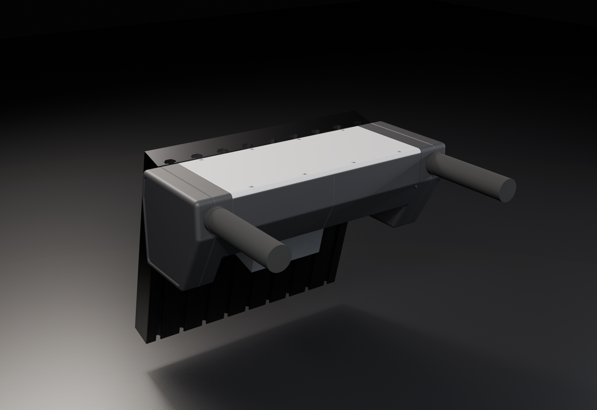

# Space bar push assist

Push-assist handles for a powered wheelchair. A load cell in each handle measures how hard the
attendant pushes. The sum of the two forces is the forward command, and the difference is the
turn. An ESP32 reads both cells and sends push-assist commands to the MIB over RTPS
([rammp-org/rammp-rtps](https://github.com/rammp-org/rammp-rtps)).

This repo holds the mechanical concept: a parametric Blender build of the printed parts, and a 2D
profile script used to agree the shape before building it in 3D.



## Hardware

| Part | Notes |
|---|---|
| 2x 20 kg tension/compression load cell | Ø25.4 × 12.6 mm puck, M5 studs, one per handle |
| 2x SparkFun HX711 | One amp per load cell |
| Waveshare ESP32-P4 WiFi6 PoE devkit | Reads the amps, talks RTPS over Ethernet |
| Panel-mount RJ45 coupler | Through the floor of the unit |
| MTB grips | Over the printed grip spigots (Ø33 flange) |
| M8 button heads + 4040 T-nuts | Bolt the unit to the chair's back plate |

Printed in PLA on a Bambu H2D. This is an R&D test unit.

## Current design (round 6)

The unit mounts on the back plate of a Permobil Corpus seat. That plate is a row of vertical 4040
extrusions leaning 15° past vertical.

- One unit, not two pods. The bridge between the handles holds the electronics, and each end
  carries a fin with a handle. Handles are 14 in apart.
- The side section is a wedge. The top is level with the grip axis, the rear face slopes at
  60°, and the front face sits flat on the plate for 40 mm before turning vertical.
- The bridge is 92 mm tall so it clears the seat's central block (the one that holds the
  armrests). The fins run down to 140 mm.
- In each handle, the grip pushes a piston that slides in a sleeve. The sleeve takes the bending,
  so the load cell only sees push and pull.

Every screw joint is a countersunk bolt into a captive nut or a T-nut. Nothing threads into
plastic. `HANDOFF.md` has the full design state, history and open items.

## Printing

`cad/blender/export_prints.py` writes STLs in print orientation and 3MF plates to `cad/print/`
(not committed). PLA, no supports. `cad printcheck` passes every part with no supports.

| Plate | Printer | Parts |
|---|---|---|
| `tonight_H2D_trays_pistons.3mf` | H2D | Tray L, Tray R (floor down), Piston L, Piston R (standing). Brim on the pistons. |
| `tonight_P1S_fins_standing.3mf` | P1S | All four fin halves standing on their bottom edge. Brim, 3+ walls. |
| `plate_1_fins.3mf`, `plate_2_trays.3mf`, `plate_3_covers_pistons.3mf` | H2D | The full set with fins lying flat, plus the covers |

The covers are cosmetic. The unit works without them.

## Assembly

This is the first build of round 6. Nothing has been fit-checked in CAD (`cad check`) yet, so do
the first fin-to-tray bolt-up loosely and check that it fits before tightening everything.

### Hardware

| Qty | Part | Where |
|---|---|---|
| 4 | M8 × 16 button head (ISO 7380) + 4040 M8 T-nut | Tray land to chair plate. Use 20 mm if your T-nuts sit deep. |
| 6 | M4 × 20 countersunk (DIN 7991) + M4 nut | Tray end wall to fin, 3 per side |
| 12 | M3 × 35 countersunk + M3 nut | Fin halves together, 6 per fin |
| 12 | M3 × 10 countersunk + M3 nut | Boards to standoffs (ESP32 4, each HX711 4) |
| 2 | M3 × 10 countersunk + M3 nut | RJ45 coupler to the tray L floor |
| 4 | M5 nut | Load cell studs, 2 per handle |
| 2 | Ø15 M5 washer | Front of each load cell, behind the 6 mm floor |
| 2 | Ø10 M5 washer | Rear of each load cell, on the piston face |
| 2 | Lock-on MTB grip, 22.2 mm ID | Over the piston spigots |
| | PTFE tape | Piston sleeve |

Tools: 2.0, 2.5 and 5 mm hex keys, an 8 mm spanner, and a 1/4 in drive 8 mm socket on a ~150 mm extension.

### Handles (do each side on the bench)

1. **Nuts into the inboard half.** Press M3 nuts into the six hex pockets on the inboard face.
   Drop M4 nuts into the three slots that open on the split face. The inboard half is the one
   with hex pockets, and the outboard half has countersinks.
2. **Load cell, front joint.** Lay the cell in its pocket in the inboard half with the wire boss
   pointing down into the boss slot. Pass the front stud through the 6 mm floor. In the void
   behind the floor, fit the Ø15 washer and an M5 nut, and tighten it with the 8 mm spanner. Turn
   the nut, not the cell, so the boss stays in its slot.
3. **Lead.** Run the lead down the channel from the boss, round the bend, and out through the
   fin's inner face. Leave the straight run under the sensor straight.
4. **Piston.** Wrap the piston sleeve in PTFE tape. Slide it into the bore with the key rib up in
   the key slot and the cell's rear stud through the piston's stud hole.
5. **Close the fin.** Put the outboard half on, and drive the six M3 × 35 from the outboard face
   into the nuts. Make sure the lead isn't pinched in the parting line.
6. **Load cell, rear joint.** Put the Ø10 washer and an M5 nut on the rear stud, down the Ø16
   spigot bore. Tighten with the 8 mm socket on the extension. Again, turn the nut, not the cell.
7. **Grip.** Slide the MTB grip onto the spigot and lock it.

### Bridge

8. **Electronics.** In tray L, screw the ESP32 to its four standoffs, with M3 × 10 up from under the
   floor and nuts on top, so its Ethernet jack faces the rear. Fit the RJ45 coupler through the floor
   hole behind it, with two M3 into the captive nuts in the pad. Fit the left HX711 on its standoffs
   in tray L, and the right HX711 in tray R. The JP4 (load cell) end of each amp faces outboard.
9. **Fin to tray.** Feed the lead through the hole in the tray's end wall. Hold the fin against the
   end wall and drive three M4 × 20 from inside the tray into the fin's nuts.
10. **Lead to amp.** Connect the load-cell conductors to the HX711's JP4 (usually red E+, black
    E-, white A-, green A+; check your cell's datasheet).

### On the chair

11. **T-nuts.** Slide four M8 T-nuts into the Corpus back plate's slots: the slot either side of
    centre and the third slot out on each side (x = ±40 and ±120 mm). The CAD assumes a 9-bar plate
    with slots on a 40 mm pitch, so check the bosses line up with your plate's slots first.
12. **Hang each half.** Sit each tray-and-fin half on the plate with its top flush with the top of
    the plate and the land flat on the plate. Drive two M8 × 16 per half from inside the tray into
    the T-nuts. The two tray halves meet at the centreline. The plate is the spine, and nothing
    joins the halves to each other.
13. **Wiring.** Run each HX711's DT/SCK/VCC/GND to the ESP32's header. The pins are set by the
    firmware. The right amp's wires cross the centreline into tray L. Plug a short patch cable from
    the coupler to the ESP32 jack, and the PoE cable into the coupler from underneath.
14. **Check.** Push and pull each grip. The piston should slide without catching, and the unit
    should not rock on the plate.

## Layout

| Path | What |
|---|---|
| `cad/blender/build_concept.py` | The whole concept. All design numbers are in the `P` dict at the top. |
| `cad/blender/check_wires.py` | Checks load-cell lead clearance and bend radius |
| `cad/blender/export_prints.py` | Print-oriented STLs and 3MF plates into `cad/print/` |
| `cad/blender/parts/` | Bought-part STLs exported from Onshape by `export_parts.mjs` |
| `cad/blender/renders/` | Review renders and `print_check.txt` (part sizes vs the H2D bed) |
| `cad/profile/profile.py` | 2D side and back profile on the chair plate |
| `cad/featurescript/` | Onshape FeatureScript for the bought parts |

## Running

Blender 5.1 and [uv](https://docs.astral.sh/uv/).

```bash
# 2D profile -> cad/profile/profile.png (seconds)
uv run --with matplotlib python cad/profile/profile.py

# Full build and all renders (about 4 minutes)
/Applications/Blender.app/Contents/MacOS/Blender -b -P cad/blender/build_concept.py

# Quick coarse build of two views
PA_VOXEL=1.2 /Applications/Blender.app/Contents/MacOS/Blender -b -P cad/blender/build_concept.py -- 01_hero 02_side

# Lead clearance check on the saved build
/Applications/Blender.app/Contents/MacOS/Blender -b cad/blender/push_assist_concept.blend -P cad/blender/check_wires.py
```

The profile script imports Alex's plotting style from `~/code-stuff/alex-style-guide`.
The `.blend` file is generated and not committed.
